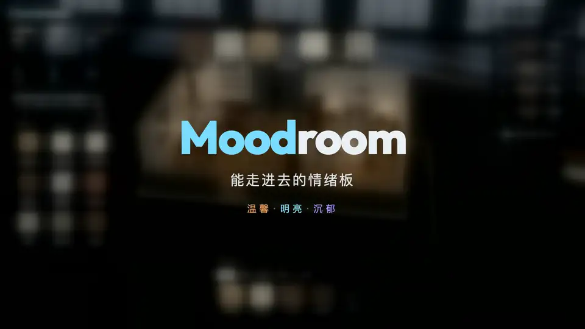
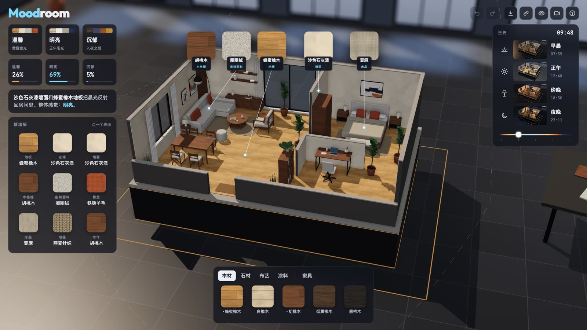

# Moodroom

能走进去的情绪板。一套掀掉屋顶的 3D 小公寓：把木材、石材、布艺和涂料拖到墙面、地面和软装上，摆家具，拖太阳，房间会实时读出「温馨 / 明亮 / 沉郁」。



▶ 带背景音乐的完整视频（15 秒，1080p）：[下载 MP4](https://github.com/OpenFabrica/moodroom/raw/master/media/moodroom-demo.mp4)



## 功能

- **材质**：从底部托盘拖样品到表面，先出现一块圆形预览，松手后铺满整个表面。
- **家具**：拖进房间、拖动、转向、移除；对齐 10 厘米网格，靠墙自动贴墙，不穿墙、不重叠。
- **日光**：沿轨迹拖太阳或拖滑块；早晨、正午、傍晚、夜晚四张实时预览；天黑后台灯亮起。
- **情绪仪表**：根据表面明度、冷暖、柔软度和光线，算出三种感觉的比例，并给一句解释。
- **其他**：三个预设、撤销/重做、保存图片、分享链接、电影镜头、渲染设置（`⌘'`）。

## 运行

```sh
npm install
npm run dev     # 开发
npm run build   # 构建到 dist/
```

## 技术

- Vite + three.js，无框架，纯前端。
- 所有贴图都由程序生成，没有外部素材。
- 后期：GTAO 环境光遮蔽、带清楚区的景深、泛光、SMAA。

## 致谢

交互形式受 [sael.net/interior](https://sael.net/interior/) 启发。本项目代码、模型和贴图均为独立实现。
